<div align="center">

<picture>
  <source media="(prefers-color-scheme: dark)" srcset="assets/White-Main-Logo.svg">
  <source media="(prefers-color-scheme: light)" srcset="assets/Black-Main-Logo.svg">
  
</picture>

**The stateful, agentic API layer for [vLLM](https://github.com/vllm-project/vllm), written in Rust 🦀**

*Run OpenAI-grade agentic workloads (Responses and Messages APIs, server-side tools, Codex, Claude Code) on your own GPUs.*

[](LICENSE)
[](Cargo.toml)
[](https://github.com/vllm-project/agentic-api/actions/workflows/rust.yml)
[](https://github.com/vllm-project/agentic-api/actions/workflows/pre-commit.yml)

</div>

______________________________________________________________________

## 🧠 Overview

vLLM gives you state-of-the-art inference throughput. But real agentic applications need more than raw tokens: they need **conversation state, tool-call loops, and multi-turn orchestration**. Today, all of that complexity lives in your client code.

**Agentic API moves it server-side.** It is a Rust-native gateway that sits in front of vLLM and owns the stateful agentic APIs, starting with an OpenAI-compatible [Responses API](https://platform.openai.com/docs/api-reference/responses). vLLM is one supported backend, not part of the Agentic API product name. Your application makes *one API call* and the server handles the rest: state hydration, tool execution, streaming, and continuation.

```mermaid
flowchart LR
    C(["🧑‍💻 Client<br/>Codex · Claude Code · SDKs · curl"]) -->|"📮 <code>POST /v1/responses</code> · <code>/v1/messages</code><br/>🌐 HTTP&nbsp;&nbsp;📡 SSE&nbsp;&nbsp;🔌 WebSocket"| A
    subgraph A ["⚡ Agentic API (Rust 🦀)"]
        direction TB
        S["🔄 State hydration<br/><code>previous_response_id</code>"]
        T["🛠️ Server-side tools<br/>web search · web fetch · MCP · code interpreter"]
        P["💾 Persistence<br/>SQLite · PostgreSQL"]
    end
    A -->|"🚀 <code>POST /v1/responses</code> · <code>/v1/messages</code><br/>⚙️ stateless&nbsp;&nbsp;🤝 OpenAI/Anthropic-compatible"| V(["🚀 vLLM core<br/>inference engine"])

    classDef client fill:#FFE8B3,stroke:#F59E0B,stroke-width:2px,color:#7C2D12
    classDef inner fill:#E0E7FF,stroke:#6366F1,stroke-width:2px,color:#312E81
    classDef engine fill:#DCFCE7,stroke:#22C55E,stroke-width:2px,color:#14532D

    class C client
    class S,T,P inner
    class V engine
    style A fill:#F5F3FF,stroke:#8B5CF6,stroke-width:2px,color:#5B21B6
    linkStyle 0 stroke:#F59E0B,stroke-width:2px
    linkStyle 1 stroke:#22C55E,stroke-width:2px
```



> [!TIP]
> Point [OpenAI Codex](https://github.com/openai/codex) at Agentic API and drive it entirely with open models served by vLLM. No OpenAI account required.

## ✨ Key Features

- 🔄 **Stateful conversations**: the server manages history through `previous_response_id` or the Conversations API, so clients stop replaying full transcripts.
- 🛠️ **Server-side tools**: an explicit [ownership model](#-tool-ownership) decides what runs where. Web search (You.com, Brave, Tavily, Serply, Keenable, or SearXNG), web fetch, MCP, file search, and an opt-in embedded code interpreter run on the gateway.
- 🤝 **Multi-agent orchestration**: one Responses request can spawn and coordinate subagents server-side ([details](#-multi-agent-responses)).
- 📡 **Every transport**: non-streaming HTTP, SSE streaming, and WebSocket with `stream_id` multiplexing.
- 🧰 **Codex and Claude Code ready**: Codex-shaped Responses traffic and Anthropic Messages traffic keep the tool declarations and item shapes each client depends on.
- 🗜️ **Compaction**: automatic and explicit context compaction through `/v1/responses/compact` ([guide](docs/guides/responses-compaction.md)).
- 🔭 **Observability**: opt-in OpenTelemetry traces and metrics over OTLP ([guide](docs/deploying/observability.md)).
- ✅ **Compatibility tested**: validated against the [Open Responses](https://www.openresponses.org/) suite, with replay-cassette tests for OpenAI, vLLM, SGLang, and NVIDIA Dynamo traffic.

## 🧭 API Surface

| Endpoint | Description |
| --- | --- |
| `POST /v1/responses` · `GET /v1/responses` (WebSocket) | Responses API with state, tools, and streaming |
| `GET` · `DELETE /v1/responses/{id}` · `GET /v1/responses/{id}/input_items` | Retrieve, delete, and list the input of a stored response |
| `POST /v1/responses/compact` | Compact direct input or a stored response chain |
| `/v1/conversations` · `/v1/conversations/{id}/items` | Conversations API |
| `POST /v1/messages` · `POST /v1/messages/count_tokens` | Anthropic Messages API with a server-side loop for gateway-owned tools |
| `/v1/files` · `/v1/vector_stores` | Files and vector stores for the `file_search` tool ([guide](docs/api/file-search.md)) |
| `GET /v1/models` · `GET /v1/models/{model}` | Model listing from the upstream |
| `/v1/chat/completions` · `/v1/completions` · `/v1/embeddings` · `/v1/audio/*` | Forwarded to the upstream unchanged |
| `GET /health` · `GET /ready` | Liveness and readiness probes |
| `GET /swagger-ui` · `GET /openapi.json` | OpenAPI spec, served when `ENABLE_OPENAPI_DOCS=true` |

Planned: stateful Messages and the Interactions API. See the [API reference](docs/api/index.md) for routing,
authentication, retrieval, and WebSocket details.

## 🚀 Quickstart

**1. Serve a model with vLLM.** Any recipe from [recipes.vllm.ai](https://recipes.vllm.ai) works:

```bash
vllm serve Qwen/Qwen3-30B-A3B-FP8 \
  --tool-call-parser qwen3_coder --enable-auto-tool-choice \
  --reasoning-parser qwen3 --port 5050
```

[NVIDIA Dynamo](docs/guides/dynamo-upstream.md) and [SGLang](docs/guides/sglang-upstream.md) upstreams work too.

**2. Start Agentic API** in front of it. Web search is optional; pick a [provider](docs/guides/web-search.md) and set its key:

```bash
AGENTIC_WEB_SEARCH_PROVIDER=brave BRAVE_API_KEY=<your-brave-api-key> \
  cargo run -p agentic-server -- --llm-api-base http://127.0.0.1:5050
```

Or use the published package instead of building (see [Python installation](#-python-installation)).

**3. Make a stateful call:**

```bash
curl http://localhost:9000/v1/responses \
  -H "Content-Type: application/json" \
  -d '{
    "model": "Qwen/Qwen3-30B-A3B-FP8",
    "input": "What is new in vLLM this month?",
    "tools": [{"type": "web_search"}]
  }'
```

Pass the returned `id` as `previous_response_id` to continue, and the server rehydrates the history for you.

### One command for Codex or Claude Code

The `agentic` CLI starts the gateway and launches a harness with an isolated configuration:

```bash
cargo build -p agentic-server --bins
./target/debug/agentic run codex --upstream http://127.0.0.1:5050
./target/debug/agentic run claude --upstream http://127.0.0.1:5050 --model Qwen/Qwen3-30B-A3B-FP8
./target/debug/agentic validate --upstream http://127.0.0.1:5050 --harness codex   # preflight checks only
```

The model defaults to the first one the upstream lists. SQLite is the default store; pass `--database-url
postgresql://...` for a shared session. See the [quickstart guide](docs/guides/quickstart.md) and
[harness CLI testing](docs/guides/harness-cli-testing.md), including
[Claude Code with a self-hosted model](docs/guides/harness-cli-testing.md#claude-code-with-a-self-hosted-model).

## 🐍 Python installation

The [`agentic-api` package on PyPI](https://pypi.org/project/agentic-api/0.10.0/) bundles the Rust gateway, the
`agentic` CLI, and a small Python launcher. Wheels cover Linux x86_64 (glibc 2.17+), macOS Intel, and macOS Apple
Silicon on Python 3.10+.

```bash
uvx --from agentic-api==0.10.0 agentic --version
uvx --from agentic-api==0.10.0 agentic serve --upstream http://existing-vllm:8000

python -m pip install agentic-api==0.10.0                # remote mode, no vLLM
python -m pip install "agentic-api[local]==0.10.0"       # also installs the pinned vLLM runtime
```

With uv:

```bash
uv pip install agentic-api==0.10.0
uv pip install "agentic-api[local]==0.10.0"
uvx --from agentic-api==0.10.0 agentic-api doctor
uvx --from agentic-api==0.10.0 agentic-api serve --vllm-base-url http://existing-vllm:8000
```

See [Python installation and workflows](docs/guides/python-installation.md) for managed vLLM, `doctor` output, and
known-good model profiles.

## 🤖 Codex on your own GPUs

Agentic API speaks the Responses wire protocol Codex expects, including WebSockets. Add a provider to
`~/.codex/config.toml`:

```toml
[model_providers.agentic-api]
name = "OpenAI"
base_url = "http://localhost:9000/v1"
wire_api = "responses"
requires_openai_auth = false
supports_websockets = true
```

```bash
codex --disable image_generation -c model_provider=agentic-api -m Qwen/Qwen3-30B-A3B-FP8
```

For the desktop app, see [Codex Desktop with local models](docs/guides/codex-desktop.md). With OIDC enabled, replace
`requires_openai_auth = false` with Codex's command-backed bearer authentication; see
[GitHub authentication with Dex](docs/deploying/github-oidc.md).

## 🧑‍💻 Claude Code on your own GPUs

Agentic API serves the Anthropic Messages protocol at `/v1/messages`, so Claude Code (CLI or Agent SDK) runs against
open models:

```bash
export ANTHROPIC_BASE_URL="http://localhost:9000"
export ANTHROPIC_API_KEY="<your-key>"
export ANTHROPIC_MODEL="Qwen/Qwen3-30B-A3B-FP8"   # match the served model

claude -p "summarize the files in this directory"
```

Claude Code's own tools stay client-owned. Its native web search and web fetch tools run on the gateway; see
[Gateway server tools on `/v1/messages`](docs/guides/messages-server-tools.md). With OIDC enabled, send the token in
`ANTHROPIC_AUTH_TOKEN` and leave `ANTHROPIC_API_KEY` unset ([GitHub authentication with Dex](docs/deploying/github-oidc.md)).

## ⚙️ Configuration

Agentic API reads `~/.agentic-api/config.toml` and generates it on first run. CLI arguments and environment variables
take precedence over the file, so secrets can stay in the environment:

```toml
llm_api_base = "http://127.0.0.1:5050"

[web_search]
provider = "brave"
```

- [Configuration](docs/guides/configuration.md): storage, request and rate limits, model capabilities, response limits, and MCP servers.
- [Web search providers](docs/guides/web-search.md): provider settings and how each one maps the shared tool contract.
- [Embedded code interpreter](docs/design/embedded-code-interpreter.md): the opt-in `embedded-code-interpreter` build feature.
- [Deploying](docs/deploying/README.md): containers, Kubernetes, and observability.

## 🧩 Tool Ownership

Every tool call has exactly one execution path, so nothing runs by accident:

| Ownership | Who executes it | Examples |
| --- | --- | --- |
| **Gateway-owned** | Agentic API, which then continues the loop | Web search, web fetch, MCP, file search, code interpreter (opt-in) |
| **Client-owned** | Returned to the client | Shell tool, Codex editor tools, your functions |
| **Provider-owned** | Passed through to vLLM or an upstream provider | Provider-native tools |

Unknown or ambiguous tool shapes are **never executed by default**. They are preserved and returned.

## 🤝 Multi-agent Responses

Set `multi_agent.enabled` and the gateway runs the
[Responses multi-agent](https://developers.openai.com/api/docs/guides/responses-multi-agent) loop itself: the root
agent spawns subagents, each with its own history and tools, and the response returns their attributed
`multi_agent_call`, `multi_agent_call_output`, and `agent_message` items.

```bash
curl http://localhost:9000/v1/responses \
  -H "Content-Type: application/json" \
  -d '{
    "model": "Qwen/Qwen3-30B-A3B-FP8",
    "store": true,
    "multi_agent": {"enabled": true, "max_concurrent_subagents": 3},
    "input": "Have one agent review correctness and another review test coverage, then summarize."
  }'
```

It works over HTTP, SSE, and WebSocket. Continue a stored agent tree with `previous_response_id`; with `store: false`,
send the complete item history on each request. See the [API reference](docs/api/index.md#responses) and
[multi-agent execution](ARCHITECTURE.md#http-multi-agent-execution) for the details and limits.

## 🏗️ Repository Layout

```
crates/
├── agentic-server/       # Axum binary, transport handlers (HTTP/SSE/WS), configuration, `agentic` CLI
├── agentic-server-core/  # Protocol types, executor, tool framework, persistence
├── agentic-llm-d/        # Split-execution state backend for the llm-d coordinator
├── agentic-cli-docs/     # Build-time generator for the CLI reference docs
└── agentic-praxis/       # Praxis gateway integration
python/agentic_api/       # Python distribution and launcher for the packaged gateway
docs/                     # MkDocs documentation, ADRs, and design notes
```

## 🛠️ Developing

```bash
cargo build                                  # build
cargo test                                   # test
cargo clippy --all-targets -- -D warnings    # lint
cargo fmt -- --check                         # format check
uv run mkdocs serve                          # docs (after: uv pip install -r docs/requirements.txt)
```

Read [ARCHITECTURE](ARCHITECTURE.md) and [CONTRIBUTING](CONTRIBUTING.md) before opening a PR. Design decisions live
in [docs/adr/](docs/adr/) and [docs/design/](docs/design/).

## 🗺️ Roadmap at a Glance

- [x] **Responses API hydration**: stateful continuation with `previous_response_id`
- [x] **Codex support**: practical Codex sessions through the Responses API
- [x] **Server-side tool execution**: explicit ownership, web search, web fetch, MCP, and code interpreter built in
- [x] **Messages API**: Claude Code support with a server-side gateway tool loop
- [x] **Conversations API**: OpenAI-compatible conversation and item management
- [x] **Multi-agent Responses**: stateful and stateless execution over HTTP and WebSocket
- [x] **File search**: Files and vector-store APIs with a gateway-executed `file_search` tool
- [ ] **Stateful Messages**: Messages continuation on the same persistence and execution primitives
- [ ] **Interactions API**: durable, higher-level agentic workflows
- [ ] **Production hardening**: tenant-scoped state and cached-prefix continuation

______________________________________________________________________

## 📄 License

Licensed under the [Apache License 2.0](LICENSE).

<div align="center">

**⭐ If Agentic API saves you from writing one more client-side tool loop, star the repo! ⭐**

</div>
