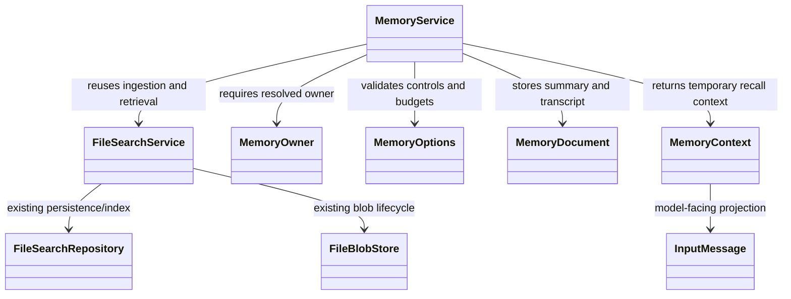

# Conversation memory: local prototype and integration proposal

Status: **library prototype**. Integration RFC:
[#563](https://github.com/vllm-project/agentic-api/issues/563). This does not enable memory on `/v1/responses`, add an OpenAI wire tool, or change stored item history.
No inference, model summarization, or automatic background writes run in this slice.

## Behavioral reference

The reference is OGX's [read path #6162](https://github.com/ogx-ai/ogx/pull/6162),
[write path #6163](https://github.com/ogx-ai/ogx/pull/6163), and
[default memory store #6267](https://github.com/ogx-ai/ogx/pull/6267). The local
OGX implementation and `docs/docs/building_applications/tools.mdx` establish:

- Memory is deployment opt-in. The normal authenticated request needs no additional
  payload. `memory.enabled=false` skips both reads and writes for that request.
- Resolve the owner from verified authentication first. Client-supplied owner
  metadata is only a fallback in a deployment without authenticated identity.
  A blank authenticated identity must never fall back to a client-supplied owner.
- Use the latest user text to retrieve relevant summaries and transcripts before
  inference. AND mandatory memory and owner attributes with optional request filters.
- Inject bounded, temporary model context. Do not emit memory `file_search_call`
  items, annotations, or citations, and do not persist injected memory as history.
- After a completed, stored response, summarize the conversation into a Markdown
  file with a bounded searchable transcript. Debounce writes and replace the prior
  memory artifact for that owner/conversation/store.
- Lazily provision a private default store per deployment namespace and durably
  retain its ID across restarts. OGX uses an internal principal and ABAC for this.

The [official memory documentation](https://learn.chatgpt.com/docs/customization/memories)
describes carrying useful context across chats and separate controls for using and
generating memories. It does not specify OGX's `memory` request extension or its
storage layout. Treat this as an intentional Agentic API extension inspired by
ChatGPT's behavior; do not claim OpenAI API parity or access to ChatGPT memory.

## Implemented slice

`types/memory.rs` owns typed owner, options, and document contracts.
`tool/memory/` owns memory ingestion, filtered recall, bounded context formatting,
and deletion. It composes `FileSearchService`; there is no new retrieval engine,
blob provider, database schema, parser, or tool loop.

An application explicitly opens an existing dedicated vector store with
`MemoryService::open`. Constructing the service is the opt-in. Calls must supply a
resolved `MemoryOwner`; no ownerless recall method exists. `remember` skips
unstored, unsuccessful, and request-disabled writes. Empty summaries publish
nothing; oversized summaries and invalid identifiers fail before upload.
Summaries are capped at 8192 bytes and transcripts at 20,000 UTF-8 bytes.

`recall` retains the configured file-search default: hybrid when embeddings are
configured, keyword otherwise. Additional filters cannot remove the mandatory
owner or memory constraints. Ranking errors propagate; a missing store yields no
memory. The caller chooses how to handle other failures.

`MemoryContext` contains only temporary model context. JSON-encoded excerpts are
framed as untrusted historical data, with current user statements taking precedence.
The complete formatted context stays within four bytes per configured approximate
token, including framing and escaping. This is a byte bound, not a tokenizer's
exact token count. A budget too small to fit the framing returns no context.

`forget` checks memory and owner attributes, then uses the existing Files deletion
transaction to remove metadata, attachments, and searchable chunks together.
A failed SQL deletion preserves the attachment so the operation can be retried.
Failed blob removal retains the existing durable cleanup intent. Delete failures
remain visible to the caller.

The prototype writes immutable artifacts. It does **not** yet implement automatic
summarization, conversation replacement, durable write jobs, deduplication, default
store provisioning, settings, an HTTP interface, or memory management UX. Repeated
writes can duplicate or conflict until replacement is implemented. Callers must
await writes; cancelling after upload can leave an unattached uploaded file. There
is no process-local cache whose loss breaks recall, and no new background worker.

## Proposed integration using the existing request path

Before changing a protected core contract, follow the repository's
[maintainer standards](../../.agents/skills/maintainer-standards/SKILL.md) and
[protected-core rules](../../.agents/skills/maintainer-standards/references/protected-core.md):
obtain maintainer agreement on [RFC #563](https://github.com/vllm-project/agentic-api/issues/563).
This prototype does not change the protected request path.

1. **Admission and types.** Add a typed, documented `memory` request extension and
   operator configuration, disabled by default. Treat use and generation as separate
   controls. Resolve a trusted identity in transport from OIDC issuer/subject and
   workspace, and bind it to the turn through an agreed typed seam. Do not derive
   identity from unverified JWT payloads, forwarded headers, shared upstream API
   keys, or `safety_identifier` in authenticated deployments. Persist neither
   credentials nor temporary recall context.
2. **Recall.** The existing upstream projection owns temporary model input.
   Retrieve once for the active turn using the submitted latest user text, and
   retain bounded recall state with its agreed owner. Add context only to the
   model-facing request after canonical input conversion. Keep it out of
   `new_input_items`, response fields, compaction history, and continuation metadata.
   A request opt-out must prevent cached/inherited memory from appearing again.
3. **Durable completion.** The single persistence boundary establishes when a
   response is completed and stored. An executor mode handler should enqueue the
   memory work only after that commit succeeds. No trigger belongs in SSE framing,
   normalization, ingestion, or client delivery. JSON, SSE, WebSocket, sessions,
   and split execution must share this boundary rather than install separate hooks.
4. **Write state.** Add portable storage models and a migration for namespace/store
   mappings plus memory records keyed by owner/conversation/store. Track the source
   response and a generation/claim token. Debounce by updating a durable due time;
   bound jobs by count and retained bytes. Lease expiry permits crash recovery;
   token-fenced publication prevents older workers from replacing newer memory.
   A failed new write leaves the previous artifact readable. Successful publication
   supersedes the prior file; delete superseded blobs with retryable cleanup.
5. **Summarization.** Reuse the existing inference transport with a bounded typed
   summarization request, isolated from tools and recursive memory generation.
   Select user/assistant text from the canonical history; exclude secrets,
   instructions, reasoning, and tool payloads. Generate durable preferences and
   facts, preserve a bounded searchable transcript, and skip empty summaries.
   Decide model selection, metering, and failure reporting explicitly.
6. **Lifecycle and user control.** Bound worker count, payload size, execution
   timeout, shutdown, cancellation, and joins. Forgetting a memory must fence any
   in-flight job so it cannot recreate the deleted data. Disabling memory and
   deleting history/memories need explicit, documented separate semantics.

### Isolation that must precede exposing an HTTP feature

The service's owner filter is **not** an access-control boundary for the existing
Files and Vector Stores APIs. Those APIs can inspect their underlying artifacts;
the prototype has not installed OGX's internal-principal/ABAC equivalent. A private
memory collection must be inaccessible to ordinary file-store list, search, content,
mutation, and deletion paths, even with a known file/store ID. Reserve that policy
in the owning services before enabling automatic writes in a shared deployment.
Never advertise this library prototype as tenant-secure HTTP memory.

## Verification

Run the real database/blob round trip without model credentials:

```bash
cargo run -p agentic-server-core --example memory_demo
cargo test -p agentic-server-core --test memory_service
```

The demo writes Alice's teal launch color, closes and reopens SQLite, recalls it,
checks Bob cannot recall it through `MemoryService`, deletes it, and checks recall
is empty. Tests cover these operations plus mandatory filter conjunction,
non-memory exclusion, opt-out/read-only controls, unstored/unsuccessful responses,
transcript-only detail recall, Unicode and escaped-text budgets, oversized input,
invalid ranking options, missing stores, and attachment-failure cleanup.

This is service evidence using actual SQL ingestion, keyword ranking, and durable
local blobs. It does not establish live-model memory quality, HTTP/SSE/WebSocket
integration, private collection ACLs, hybrid retrieval, distributed replacement,
PostgreSQL runtime behavior, or OpenAI/ChatGPT parity. No provider cassette was
created: there is no new provider wire contract in this prototype. The production
integration needs executor tests across transports, lease/concurrency/crash tests,
forgotten-data resurrection tests, authorization checks through every Files route,
and representative long-conversation recall evaluation.

## Types and dependencies


